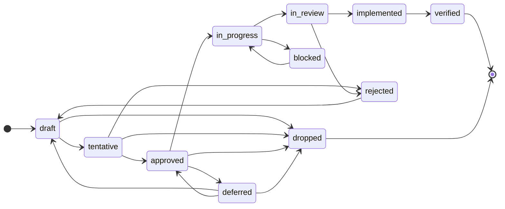

<!-- Copyright (c) 2026 CoLLMate, Inc. -->
<!-- SPDX-License-Identifier: Apache-2.0 -->
<!-- Generated from schema/ by schemadocs-generator/generate.py. Do not edit; change the schema and regenerate. -->

# 拡張SRS (Extended Software Requirements Specification) 仕様書

## I. 概要

拡張SRS（Extended SRS）は、人間とAIエージェントの両方が理解・処理できるソフトウェア要求仕様書の標準フォーマットである。
構造化マークダウン形式を採用し、可読性と機械処理性を両立する。

### 基本原則
- **最小構成から開始可能**: 必須要素から始め、段階的に詳細化
- **重複排除**: 同一情報は一箇所で管理
- **責務の明確化**: 各セクションの役割を明確に定義
- **プロジェクト適応性**: 規模や特性に応じて必要な要素のみを選択
- **統一ステータスライフサイクル**: ライフサイクルを持つ要素を共通の11種のステータスで管理
- **型付き依存関係**: 要素間の依存を構造化し、依存グラフを自動構築
- **Human-Agent協調**: ワークフロー設定により自律度と承認ゲートを宣言的に定義

## II. 基本構造

**人間も編集するコンテンツに、AIが管理するメタデータを区間ベースで関連付ける**

### II.0. ファイル構成ルール

#### II.0.1 エントリーファイル

拡張SRS形式のプロジェクトは、必ず **`srs.md`** という名前のエントリーファイルを1つ持たなければならない。

- **ファイル名**: `srs.md`（固定、変更不可）
- **配置**: プロジェクトルート直下
- **必須セクション**: `manifest` セクションを必ず含む
- **役割**: 拡張SRS文書の起点として、AIエージェントおよびツールが最初に読み込むファイル

#### II.0.2 単一ファイル構成

小規模プロジェクトでは、`srs.md` 内にすべてのメタデータとコンテンツを記述する。

```
project/
└── srs.md    # すべてのSRS情報を含む
```

#### II.0.3 分散ファイル構成

大規模プロジェクトでは、`srs.md` をエントリーファイルとし、他のファイルに分散して記述する。

```
project/
├── srs.md                    # エントリーファイル（必須）
├── chapters/
│   ├── 01_project_overview.md
│   ├── 02_use_cases.md
│   └── 03_requirements.md
└── design/
    └── system_architecture.md
```

- エントリーファイル `srs.md` の `manifest.files` 配列で統合対象ファイルを指定
- 配列順序でファイルを読み込み、後勝ちルールで統合

### II.1. コンテンツ記法

人間も編集するコンテンツは Markdown 記法（GitHub Flavored Markdown 推奨）で記述する。

コンテンツの構造は、区間ベースでメタデータを埋め込むことができれば、どのような順序でも構わないが、下記SRS構造で記載することを推奨する。

#### II.1.1 推奨されるSRS構造

```
拡張SRS文書
├── 要求仕様
│   ├── プロジェクト概要: project-overview
│   ├── ユースケース: use-cases
│   ├── 機能要件: functional-requirements
│   ├── 非機能要求: non-functional-requirements
│   ├── 制約条件: constraints
│   └── ドメインモデル: domain-model
├── 実装仕様
│   ├── システムアーキテクチャ: system-architecture
│   └── 開発実装詳細: development-implementation
└── ワークフロー: workflow
```

**要求仕様**
- **抽象度**：ビジネス要求、ユーザーニーズレベル
- **安定性**：相対的に安定、変更頻度が低い
- **ステークホルダー**：ビジネス側、プロダクトオーナー、エンドユーザー
- **目的**：「何を作るか」「なぜ作るか」を明確化

**実装仕様**
- **具体度**：技術アーキテクチャ、実装詳細レベル
- **可変性**：実装過程で頻繁に変更・詳細化
- **ステークホルダー**：開発チーム、アーキテクト、DevOpsエンジニア
- **目的**：「どう作るか」を技術的に定義
- **ソースコード互換性**：LLMによる相互変換を目指す

### II.2. メタデータ記法

#### II.2.1. 区間ベースのコンテンツ認識
- メタデータから次のメタデータまでの区間が、そのメタデータのコンテンツとして認識される
- ファイル末尾までが最後のメタデータのコンテンツとなる

#### II.2.2. 基本書式
メタデータは、**拡張SRSオブジェクトツリー**（後述）を**HTMLコメント形式でYAML記述**する

**開始・終了タグ（必須）**:
- 開始: `<!--@srs` または `<!--@srs:` （スペースなし、固定）
- 終了: `@srs-->` （スペースなし、固定）

**記述ルール**:
- `@属性指定`の直後から改行してYAMLを開始
- YAMLのリテラルスタイル（`|`）やフォールドスタイル（`>`）を活用
- Mermaid図表、複数行テキスト、オブジェクト配列も全て同じ記法

_HTMLコメント形式YAML記法_
```markdown
<!--@属性指定
# 基本的な値
key: "値"
number: 123
boolean: true

# 配列（フロースタイル）
array_flow: ["item1", "item2", "item3"]

# 配列（ブロックスタイル）
array_block:
  - item1
  - item2

# オブジェクト
nested:
  sub_key: "sub_value"
  sub_array_block:
    - "a"
    - "b"
    - "c"
  sub_array_flow: ["x", "y", "z"]

# 複数行テキスト（改行保持）
content: |
  これは複数行にわたる
  説明文である。改行が
  保持される。

# 複数行テキスト（折りたたみ）
summary: >
  これは複数行テキストが
  単一行に折りたたまれる。
  長い説明文に便利である。

# Mermaid図表
diagram: |
  graph TB
    A[Frontend] --> B[API Gateway]
    B --> C[Backend Service]
    C --> D[(Database)]

# 複雑な構造化データ
architecture:
  style: "microservices"
  components:
    - name: "frontend"
      technology: "React"
      version: "18.0"
    - name: "backend"
      technology: "FastAPI"
      version: "0.68"
  deployment:
    environment: "AWS"
    regions: ["ap-northeast-1"]
@srs-->
```

#### II.2.3. メタデータ記述ルール

メタデータの属性指定は、拡張SRSオブジェクトツリーの根本である `srs` から始まる。

##### II.2.3.1 基本記法

**全体記法**:
全メタデータを一度に記載する記法。文章の先頭で利用する

```markdown
<!--@srs
manifest:
  format: "extended-srs/v1"
  schema_version: "1.0.0"
  project_name: "My Project"
  created: 1735516800
project-overview:
  objective: |
    プロジェクトの目的説明
use-cases:
  list:
    - uc_id: "UC001"
      name: "タスク作成"
      actors: ["利用者"]
      description: "利用者がタスクを登録する。"
@srs-->
```

**部分抽出記法**:
拡張SRSオブジェクトツリーの一部だけを切り出して記述することも可能である。

```markdown
<!--@srs: project-overview: objective
|
  プロジェクトの目的説明
@srs-->

<!--@srs: use-cases: list[0]
uc_id: "UC001"
name: "タスク作成"
actors: ["利用者"]
description: "利用者がタスクを登録する。"
@srs-->
```

**パス指定規則**:
- オブジェクトパス: `@srs: project-overview: objective`
- 配列要素アクセス: `@srs: use-cases: list[0]`
- 深いネスト: `@srs: development-implementation: development_milestones: milestones[0]: name`

##### II.2.3.2 基本ルール

1. **全体記法優先原則**
   - `@srs`全体記法が存在する場合、それが基準となる
   - 各ファイルでは全体記法を記載順に適用した後、部分抽出記法を記載順に適用する
   - 部分抽出記法は配置位置にかかわらず、そのファイルの全体記法を補完・上書きする

##### II.2.3.3 配置ルール

1. **全体記法の配置**
   - ファイル先頭での配置を推奨

2. **部分抽出記法の配置**
   - 対応するコンテンツセクションの直前に配置を推奨
   - 複数の部分抽出記法は任意の順序で配置可能

3. **混在配置の例**
```markdown
<!--@srs
manifest:
  format: "extended-srs/v1"
  schema_version: "1.0.0"
  project_name: "My Project"
  created: 1735516800
@srs-->
# My Project

<!--@srs: project-overview
objective: "プロジェクトの目的"
@srs-->
## プロジェクト概要
[プロジェクト概要のコンテンツ]

<!--@srs: use-cases: list[0]
uc_id: "UC001"
name: "ユーザー登録"
actors: ["利用者"]
description: "利用者がアカウントを登録する。"
@srs-->
<!--@srs: use-cases: list[1]
uc_id: "UC002"
name: "ログイン"
actors: ["利用者"]
description: "利用者が登録済みのアカウントでログインする。"
@srs-->
## ユースケース
[ユースケースのコンテンツ]
```

##### II.2.3.4 上書きルール

1. **部分抽出による上書き**
   - 同一パスの部分抽出記法は後勝ち（最後に記述されたものが有効）
   - 部分的な上書きは該当プロパティのみ影響

2. **マージルール**
   - オブジェクトのマージ: 既存プロパティは保持、新規プロパティは追加
   - 配列全体を指定した場合は置換する。`list[0]` のようにインデックスを指定した部分抽出は、その要素に適用する

##### II.2.3.5 検証ルール

1. **パス検証**
   - Schema にないフィールドやパスも解析・集約時には保持する。Schema が禁止するものは検証の診断として知らせる
   - 公式 core は未知の部分パスをエラーとして報告する。Schema が許可する `x-*` 等の拡張は未知フィールドとして報告しない
   - 型不整合の上書きはエラー

2. **必須の要素検証**
   - JSON Schemaで定義された必須要素は必須

3. **参照整合性検証**
   - メタデータ内のID参照が適切に設定されている
   - 参照先のID要素が存在することを確認
   - JSON Schema の構造検証だけでは参照先の存在を検証できない。公式 core は着手可否・状態遷移時に依存先を確認する。その他の参照整合性は利用側で確認する

## III. 共通定義

セクション横断的に使用される共通型定義。

### III.1. ステータスライフサイクル

ユースケース、機能要件、非機能要求、モジュール、マイルストーンの `status` は共通の11種の値を使用する。これらの要素では `status` は省略可能で、公式 core の状態判定では省略時を `draft` として扱う。



| ステータス | 説明 |
|-----------|------|
| `draft` | 初期草案 |
| `tentative` | 暫定案。レビュー待ち |
| `approved` | 承認済み。実装着手可能 |
| `in_progress` | 実装中 |
| `blocked` | ブロック中。依存先の完了待ち |
| `in_review` | レビュー中 |
| `rejected` | 却下 |
| `implemented` | 実装完了。検証待ち |
| `verified` | 検証済み |
| `deferred` | 保留 |
| `dropped` | 取消 |

### III.2. 型付き依存関係

`depends_on` は文字列IDと型付きオブジェクトを混在可能：

```yaml
depends_on:
  - "UC-001"                           # 文字列ID（簡潔）
  - ref_id: "NFR-SEC-001"              # 型付きオブジェクト（詳細）
    ref_type: "non-functional-requirement"
    dependency_type: "hard"             # hard / soft / interface
```

| dependency_type | 説明 |
|----------------|------|
| `hard` | 完了必須。依存先が完了するまで開始不可 |
| `soft` | モック可。依存先をモックして先行開発可能 |
| `interface` | 契約のみ。インターフェース定義があれば実装可能 |

`blocks` は `depends_on` から導出する逆依存リストで、省略可能。公式 core は状態取得時に逆依存を計算するが、文書の `blocks` フィールドを自動更新するものではない。

### III.3. その他の共通定義

| 定義名 | 説明 |
|--------|------|
| `priority` | 優先度（MoSCoW: must/should/could/wont、または high/medium/low） |
| `tags` | 横断的分類ラベルの文字列配列 |
| `acceptanceCriterion` | GWT（Given-When-Then）形式の受け入れ条件 |
| `decisionRecord` | 決定記録（決定者、根拠、代替案、影響範囲） |
| `pendingDecision` | 未解決の意思決定事項 |

## IV. 拡張SRSオブジェクトツリー

**拡張SRSオブジェクトツリー**は、拡張SRSの全てのメタデータを含むツリー状のデータ構造である。

### トップレベル属性

以下は型と構造を示す擬似表記。実際のメタデータは II.2 の HTML コメント記法で記述する。

```text
@srs:
  manifest:                         # ✅ 文書メタ情報： 文書の識別とバージョン管理
  project-overview:                 # プロジェクト概要： プロジェクトの基本情報
  use-cases:                        # ユースケース： システムとアクターの相互作用定義
  functional-requirements:          # 機能要件： システムが提供する機能の詳細定義
  non-functional-requirements:      # 非機能要求： 品質に関する要求
  constraints:                      # 制約条件： プロジェクトの制限事項
  system-architecture:              # システムアーキテクチャ： 開発開始前に決定すべき技術基盤と設計方針
  development-implementation:       # 開発実装詳細： 開発マイルストーンの管理とデプロイメント設定に特化したスキーマ
  domain-model:                     # ドメインモデル（DDD）： ビジネスドメインの概念モデル
  workflow:                         # ワークフロー設定： Human-Agent 協調ワークフローの設定と意思決定記録
```


### IV.1. 文書メタ情報: @srs: manifest


#### 1. 文書メタ情報とは
##### 1.1 定義と本質的目的
文書メタ情報は、AIエージェントが拡張SRS形式の文書を正確に識別・解析・処理するために必要な構造化メタデータである。単なる文書管理情報ではなく、**AI連携のための形式規定**と**分散ファイル統合のための設計図**としての役割を持つ。
##### 1.2 エントリーファイル命名規則（必須）
拡張SRS形式のプロジェクトは、必ず **`srs.md`** という名前のエントリーファイルを1つ持たなければならない。

| 項目 | 規則 |
|------|------|
| **ファイル名** | `srs.md`（固定、変更不可） |
| **配置場所** | プロジェクトルート直下 |
| **必須セクション** | `manifest` セクションを必ず含む |
| **役割** | 拡張SRS文書の起点、AIエージェントが最初に読み込むファイル |

この命名規則は単一ファイル構成・分散ファイル構成のいずれにおいても適用される。`srs.md` 以外のファイル名はエントリーファイルとして認識されない。
##### 1.3 AI連携における意義
| 機能 | AI連携での役割 | 実現される価値 |
|------|-------------|-------------|
| **形式識別** | `extended-srs/v1` 形式を認識 | 適切なパーサー選択、スキーマ検証 |
| **構造理解** | 分散ファイルの全体構造を把握 | 完全な文書統合、文脈保持 |
| **統合処理** | 複数ファイルを正しい順序で統合 | 一貫性のあるSRSオブジェクト生成 |
| **検証基盤** | メタデータ整合性の自動チェック | 品質保証、エラー早期発見 |
##### 1.4 分散ファイル対応の重要性
大規模プロジェクトでは、SRSを複数ファイルに分散して管理する必要がある。エントリーファイルは：
- **全体像の保持**: 分散されたセクションの論理的関係を維持
- **読み込み順序の制御**: files配列によるファイル統合順序の明示
- **整合性の確保**: 後勝ちルールによる一貫した統合処理
- **AI理解の促進**: 断片化された情報を統一的なコンテキストとして提供

#### YAML構造

以下は型と構造を示す擬似表記。`✅` は必須項目、`/`・`|` は選択肢を示す。文書に貼り付ける際は具体的な値と `<!--@srs … @srs-->` の記法を使用する。省略した制約や拡張条件は JSON Schema を参照する。

```text
@srs:
  manifest:  # 文書メタ情報：文書の識別とバージョン管理
    format: "extended-srs/v1"  # ✅ フォーマット：拡張SRSフォーマットの識別子。必ず"extended-srs/v1"を指定（固定値）。パーサーやバリデーターが適切な処理方式を選択するために使用。仕様変更時は新しいバージョン識別子を定義
    schema_version: "string"  # スキーマバージョン：使用している拡張SRSスキーマのバージョン番号（例: "1.0.0"）
    project_name: "string"  # ✅ プロジェクト名：プロジェクトの識別名。組織内で一意の名称を設定し、文書の分類と検索に使用。人間が理解しやすく検索しやすい表現を使用。略語や曖昧な表現は避ける
    created: number  # 作成日時：SRS文書の初回作成タイムスタンプ。Unixタイムスタンプ形式（UTC、秒単位）で記録。文書のライフサイクル管理と履歴追跡に使用。作成後は変更不可（不変性）。ツールによる自動設定を推奨
    updated: number  # 更新日時：SRS文書の最終更新タイムスタンプ。Unixタイムスタンプ形式（UTC）で記録。変更検知とキャッシュ管理に使用。CI/CDパイプラインでの自動更新を推奨。ファイル変更時は確実に更新し、定期的な更新状況の監視が必要
    authors:  # 作成者：SRS文書の作成者と責任者の一覧。「役割: 氏名」形式での記述を推奨（例："Business Analyst: 田中太郎"）。各役割の責任範囲を明確化し、必要に応じて連絡先情報も併記
      - "string"  # 作成者名（「役割: 氏名」形式を推奨）
    files:  # 分割されたファイルリスト：分散ファイル構成時の統合対象ファイルパス配列。配列順序で各ファイルを読み込み、後勝ちルールで統合（後続ファイルの同一パスメタデータが前のファイルを上書き）。セキュリティのため相対パス指定のみ許可、../によるディレクトリ遡りは禁止。単一ファイル構成では省略
      - "string"  # 相対パス
```


### IV.2. プロジェクト概要: @srs: project-overview


#### 1. プロジェクト概要とは
##### 1.1 定義と本質的目的
プロジェクト概要は、拡張SRS文書の出発点となる最重要セクションである。プロジェクトの存在意義、解決すべき課題、実現すべき価値を明確に定義し、すべてのステークホルダーが共通の理解を持つための基盤を提供する。
##### 1.2 プロジェクト概要の役割
| 役割 | 説明 | 効果 |
|------|------|------|
| **方向性の明確化** | プロジェクトの目的と目標を明文化 | チーム全体の意識統一 |
| **判断基準の提供** | 意思決定の拠り所となる原則を確立 | 一貫性のある設計判断 |
| **スコープ管理** | 範囲を明確に定義し境界を設定 | スコープクリープの防止 |
| **期待値調整** | ステークホルダーの期待を適切に管理 | 認識齟齬の最小化 |
##### 1.3 他セクションとの関係
プロジェクト概要は、後続のすべてのセクションの前提となる：
- **ユースケース**: 目的を実現するための具体的な利用シナリオ
- **要求仕様**: 目的達成のために必要な機能・非機能要件
- **制約条件**: プロジェクトの境界条件と制限事項
- **システム設計**: 目的を技術的に実現する方法

#### YAML構造

以下は型と構造を示す擬似表記。`✅` は必須項目、`/`・`|` は選択肢を示す。文書に貼り付ける際は具体的な値と `<!--@srs … @srs-->` の記法を使用する。省略した制約や拡張条件は JSON Schema を参照する。

```text
@srs:
  project-overview:  # プロジェクト概要：プロジェクトの基本情報
    objective: "string"  # ✅ 目的：プロジェクトが存在する根本的な理由と実現したい未来の状態。Why（なぜ必要か）、What（何を実現するか）、Value（どのような価値を提供するか）、Success（測定可能な成功指標）を含めて記述。ビジネス価値や社会的インパクトの観点から、ステークホルダーが共感できる形で表現する（複数行可）
    context: "string"  # 背景：プロジェクトが立ち上がった経緯と必要性の根拠。現状の課題（解決すべき問題の詳細）、市場環境（競合状況、業界トレンド）、技術的背景（採用技術の選定理由）、組織的背景（企業戦略との整合性）、歴史的経緯（過去の取り組みと学び）を包括的に記述（複数行可）
    personas:  # ペルソナ：想定ユーザーの定義（B2C/プロダクト開発向けオプション）
      - #
        name: "string"  # ✅ ペルソナ名：識別名
        demographics: "string"  # 人口統計：年齢、性別、職業、居住地、収入レベル、教育レベルなどの基本属性。B2Bの場合は業界、企業規模、部門、役職なども含む
        characteristics: "string"  # 特性：性格、行動パターン、技術リテラシー、価値観、意思決定の基準など。日常の習慣や仕事のスタイルも含む
        needs:  # ニーズ：解決したい課題、達成したい目標、求める価値などの要求事項リスト
          - "string"  # 具体的な要求事項
    scope:  # スコープ：プロジェクトの境界を明確に定義。in_scope（含む範囲）とout_scope（含まない範囲）を具体的に記述。曖昧な表現を避け、測定可能で客観的に判断できる内容にする。段階的リリースを考慮し、MVP定義やフェーズ分けも明示
      in_scope:  # ✅ スコープ内：プロジェクトで実装・提供する機能、サービス、成果物の具体的なリスト。MVPとして最初に実現する項目を明確にする
        - "string"  # 実装対象の具体的な機能またはサービス
      out_scope:  # ✅ スコープ外：明示的に実装・提供しない機能、サービス、成果物のリスト。将来的な拡張可能性がある場合はその旨を記載
        - "string"  # 実装対象外の具体的な機能またはサービス（理由や代替案があれば併記）
```


### IV.3. ユースケース: @srs: use-cases


#### 1. ユースケースとは（有向グラフモデル版）
##### 1.1 定義と本質的目的
ユースケースは、アクター（ユーザーや外部システム）がシステムを使って達成したい目標と、その達成プロセスを**有向グラフ**として記述したものである。各ステップが頂点、遷移条件付きの次ステップ参照が辺となり、複雑な分岐や合流を自然に表現できる。
##### 1.2 有向グラフモデルの利点
| 利点 | 説明 | 効果 |
|------|------|------|
| **柔軟な制御フロー** | 並行処理、条件分岐、ループを自然に表現 | 実際の業務フローを正確にモデル化 |
| **再利用性** | 共通ステップを複数箇所から参照可能 | 重複記述の削減 |
| **検証可能性** | グラフ理論に基づく到達可能性や循環の検出 | 品質保証の自動化 |
| **実装との対応** | ステートマシンやワークフローエンジンと直接対応 | 設計と実装のギャップ最小化 |
##### 1.3 軽量なユースケース定義
`processing_details`（処理詳細）はオプションである。すべてのユースケースに詳細な処理フローが必要なわけではなく、必須の `uc_id`・`name`・`description`・`actors` と、任意の `business_rules`で意図（Intent）と制約（Constraint）を表現する軽量な定義も有効である。初期段階や高レベルの要件整理では、まず軽量な形式でユースケースを列挙し、必要に応じて `processing_details` を追加して段階的に詳細化するアプローチを推奨する。
##### 1.4 ビジネスルールの明示的管理
`business_rules` フィールドにより、各ユースケースに適用されるビジネスルールや制約を文字列の配列として明示的に記述する。
##### 1.5 機能要件との整合性
```
ユースケース（ビジネスレベルの相互作用）
    ↓ 同じ有向グラフモデルで詳細化
機能要件（システムレベルの処理フロー）
    ↓ 実装
ステートマシン/ワークフロー実装
```
ユースケースと機能要件が同じモデルを採用することで、シームレスな詳細化と追跡可能性を実現する。

#### YAML構造

以下は型と構造を示す擬似表記。`✅` は必須項目、`/`・`|` は選択肢を示す。文書に貼り付ける際は具体的な値と `<!--@srs … @srs-->` の記法を使用する。省略した制約や拡張条件は JSON Schema を参照する。

```text
@srs:
  use-cases:  # ユースケース：システムとアクターの相互作用定義
    list:  # ユースケースリスト：ユースケースの一覧
      - #
        uc_id: "string"  # ✅ ユースケースID：ユースケースの一意識別子
        name: "string"  # ✅ ユースケース名：アクターが達成したい具体的な目標を表す名称。「動詞＋目的語」形式推奨（例：商品注文、在庫調整）。1回のセッションで完結する適切な粒度に設定
        priority: "must"/"should"/"could"/"wont"/"high"/"medium"/"low"  # 優先度：開発優先度。ビジネス価値、技術的依存関係、リスクを総合的に評価して設定。MVPに含めるものはhighを推奨
        actors:  # ✅ アクター：主アクター（ユースケース開始者）を最初に記載。副アクター（外部システム、サービス）、時間アクター（定期実行トリガー）も含む。具体的な役割名で記述（「ユーザー」は避け「顧客」「管理者」等を使用）
          - "string"  # アクター名（具体的な役割を表す名称）
        description: "string"  # ✅ 概要：ユースケースで達成される価値と概要説明。関連するドメインモデル要素（集約、エンティティ等）への言及可。ビジネス用語を使用し、技術的詳細は避ける（複数行可）
        processing_details:  # 処理詳細：ユースケースの詳細な処理フロー
          preconditions:  # 事前条件：ステップ実行前に満たすべき条件
            required_steps:  # 必須先行ステップ：このステップ実行前に完了している必要があるステップIDのリスト（Join操作）
              - "string"  #
            system_state:  # システム状態：必要なシステム状態の条件
              - "string"  #
            actor_state:  # アクター状態：アクターが満たすべき条件
              - "string"  #
            data_state:  # データ状態：データが満たすべき条件
              - "string"  #
          postconditions:  # 事後条件：実行後に保証される状態のリスト
            - "string"  #
          steps:  # ✅ ステップ定義：すべての処理ステップを統一的に定義（有向グラフの頂点）
            - #
              id: "string"  # ✅ ステップID：処理ステップの一意識別子。推奨：処理内容を表す名前（例：select-product、validate-stock、process-payment）
              actor: "string"  # ✅ アクター：実行主体（事前定義されたアクター名）
              action_type: "input"/"display"/"validate"/"process"/"decision"/"external_call"/"notify"  # アクション種別：ステップの種類（input/display/validate/process/decision/external_call/notify）
              description: "string"  # ✅ 説明：アクションや処理の内容
              preconditions:  # 事前条件：ステップ実行前に満たすべき条件
                required_steps:  # 必須先行ステップ：このステップ実行前に完了している必要があるステップIDのリスト（Join操作）
                  - "string"  #
                system_state:  # システム状態：必要なシステム状態の条件
                  - "string"  #
                actor_state:  # アクター状態：アクターが満たすべき条件
                  - "string"  #
                data_state:  # データ状態：データが満たすべき条件
                  - "string"  #
              data_operations:  # データ操作：このステップで行うデータ操作
                - #
                  operation: "read"/"create"/"update"/"delete"/"check"  # ✅ 操作種別：データ操作の種類
                  target: "string"  # ✅ 対象：操作対象のデータエンティティやリソース
                  condition: "string"  # 条件：操作の条件（オプション）
              validations:  # 検証ルール：このステップで実行される検証
                - #
                  validation_id: "string"  # ✅ 検証ID：検証ルールの識別子
                  target: "string"  # ✅ 対象：検証対象の項目
                  rule: "string"  # ✅ ルール：検証ルールの論理式または説明
                  error_message: "string"  # ✅ エラーメッセージ：検証失敗時の表示メッセージ
              next:  # ✅ 次のステップ：遷移先の定義（有向グラフの辺）
                - #
                  step: "string"  # ✅ ステップID：遷移先のステップID（処理ステップのIDまたは'END'）
                  condition:  # ✅ 遷移条件：ステップ遷移の条件定義
                    type: "always"/"success"/"error"/"business_rule"/"user_choice"/"data_condition"/"external_event"/"timeout"  # ✅ 条件タイプ：遷移条件の種類
                    value: "string"  # 条件値：条件タイプに応じた具体的な値（ルール名、選択肢、条件式など）
                    description: "string"  # 説明：条件の詳細説明
          flows:  # フロー分類：テストシナリオ用のステップ分類
            main_flow:  # 主要フロー：正常系のステップIDリスト（ハッピーパス）
              - "string"  #
            alternative_flows:  # 代替フロー：正常系のバリエーション
              - #
                name: "string"  # ✅ フロー名：フローの名称
                trigger_step: "string"  # トリガーステップ：このフローが開始されるステップID
                steps:  # ✅ ステップリスト：含まれるステップID
                  - "string"  #
                description: "string"  # 説明：フローの目的や発生条件
            exception_flows:  # 例外フロー：エラー処理フロー
              - #
                name: "string"  # ✅ フロー名：フローの名称
                trigger_step: "string"  # トリガーステップ：このフローが開始されるステップID
                steps:  # ✅ ステップリスト：含まれるステップID
                  - "string"  #
                description: "string"  # 説明：フローの目的や発生条件
        acceptance_criteria:  # 受け入れ条件：Given-When-Then形式でユースケースの検証条件を構造化記述。各シナリオは独立して実行可能に設計。自動テスト生成の基礎となるため、具体的な値を含めて記述
          - #
            scenario: "string"  # シナリオ名：テストシナリオを識別する簡潔な名称
            flow_path:  # フローパス：このシナリオで通るステップIDの順序
              - "string"  #
            given:  # ✅ 前提条件：テスト実行前の初期状態。具体的な値を含めて記述
              - "string"  # 検証可能な前提条件
            when:  # ✅ 実行アクション：テストで実行する操作。ユーザーの具体的なアクションを記述
              - "string"  # 実行する操作
            then:  # ✅ 期待結果：アクション実行後の期待される結果。測定可能な状態変化を記述
              - "string"  # 検証可能な期待結果
        business_rules:  # ビジネスルール：このユースケースに適用されるビジネスルール・制約の一覧
          - "string"  #
        status: "draft"/"tentative"/"approved"/"in_progress"/"blocked"/"in_review"/"rejected"/"implemented"/"verified"/"deferred"/"dropped"  # ステータス：要素のライフサイクル状態
        tags:  # タグ
          - "string"  #
        depends_on:  # 依存先
          - "string" | object  #
        blocks:  # 逆依存：depends_on から導出する、この要素がブロックしている他要素の ID リスト。省略可能。文書への保存・更新は利用側で行う
          - "string"  #
        implemented_by:  # 実装先機能要件：このユースケースを実装する機能要件の ID リスト
          - "string"  #
```


### IV.4. 機能要件: @srs: functional-requirements


#### 1. 機能要件とは
##### 1.1 定義と目的
機能要件（Functional Requirements）は、システムが提供すべき具体的な機能と振る舞いを詳細に定義したものである。ユースケースで定義された「何を作るか（WHAT）」を、「どう実現するか（HOW）」の観点で具体化する。
##### 1.2 機能要件の本質
- **具体性**: 実装可能なレベルまで詳細化された仕様
- **包括性**: ビジネス要件から技術仕様まで網羅
- **トレーサビリティ**: ユースケースから実装まで追跡可能
- **検証可能性**: 明確な受け入れ条件を持つ
- **データの一元管理**: システム全体で共有されるデータを統合的に管理
- **AI制御メタデータ**: status（11段階ライフサイクル）/ tags / depends_on（型付き依存関係対応）/ blocks（逆依存）により、AIエージェントが作業スコープと実装順序を自律的に判断可能
##### 1.3 他要素との関係
```
ユースケース（アクターとシステムの相互作用）
    ↓ 実現
機能要件（具体的な機能仕様）
    ↓ 実装
システム設計（技術的な実現方法）
```
##### 1.4 データモデルの一元管理
機能要件では、システム全体で共有されるデータを`data_models`セクションで一元管理する。個別の機能要件からは`used_data`で参照のみを行い、データの重複定義を避ける。参照先の存在と意味的な整合性は別途確認する。

#### YAML構造

以下は型と構造を示す擬似表記。`✅` は必須項目、`/`・`|` は選択肢を示す。文書に貼り付ける際は具体的な値と `<!--@srs … @srs-->` の記法を使用する。省略した制約や拡張条件は JSON Schema を参照する。

```text
@srs:
  functional-requirements:  # 機能要件：システムが提供する機能の詳細定義
    data_models:  # データモデル：システムで使用するデータの定義
      - #
        data_id: "string"  # ✅ データID：データモデルの一意識別子。推奨：意味のある名前（例：user-profile、order-items）
        name: "string"  # ✅ データ名：データモデルの名称（ビジネス名）
        system_name: "string"  # システム名：システム実装時の名称（オプション）
        type: "master"/"transaction"/"reference"/"log"  # ✅ タイプ：master/transaction/reference/log
        attributes:  # ✅ 属性：データ項目の定義
          - #
            name: "string"  # ✅ 属性名：項目の識別名（ビジネス名）
            system_name: "string"  # システム名：実装時の名称（オプション）
            type: "string"/"number"/"boolean"/"date"/"datetime"/"uuid"/"id"/"integer"/"decimal"/"float"/"enum"/"json"/"array"  # ✅ データ型：データ型定義
            required: boolean  # ✅ 必須：true/false
            description: "string"  # ✅ 説明：属性の意味
            max_length: number  # 最大長：文字列型の場合
            precision: number  # 精度：decimal型の場合の全体桁数
            scale: number  # スケール：decimal型の場合の小数点以下桁数
            values:  # 値リスト：enum型の場合の選択肢
              - "string"  #
            default: "any"  # デフォルト値：初期値
            conversion: "string"  # 変換：データ変換ルール（オプション）
            constraints:  # 制約：データ制約条件
              - "string"  # 制約条件（primary_key/unique/not_null/foreign_key等）
        characteristics:  # データ特性：データの運用特性
          update_frequency: "string"  # 更新頻度：更新タイミング
          volume: "string"  # データ量：想定件数や容量
          retention: "string"  # 保存期間：データ保管期間
          partitioning: "string"  # パーティション：分割方法
    requirements:  # 個別の機能要件リスト
      - #
        req_id: "string"  # ✅ 要件ID：機能要件の一意識別子。推奨：機能を表す意味のある名前（例：user-registration、product-search）
        name: "string"  # ✅ 要件名：機能の名称
        priority: "must"/"should"/"could"/"wont"/"high"/"medium"/"low"  # ✅ 優先度：high/medium/low
        actors:  # アクター：この機能に関わるアクター名のリスト
          - "string"  #
        used_data:  # 使用データ：この機能で使用するデータIDの参照
          - "string"  #
        processing_details:  # 処理詳細：処理の詳細仕様
          preconditions:  # 事前条件：ステップ実行前に満たすべき条件
            required_steps:  # 必須先行ステップ：このステップ実行前に完了している必要があるステップIDのリスト（Join操作）
              - "string"  #
            conditions:  # 条件：ビジネスルールやシステム状態に関する条件のリスト
              - "string"  #
          postconditions:  # 事後条件：実行後に保証される状態のリスト
            - "string"  #
          steps:  # ステップ定義：すべての処理ステップを統一的に定義
            - #
              id: "string"  # ✅ ステップID：処理ステップの一意識別子。推奨：処理内容を表す名前（例：validate-input、call-api、show-results）
              actor: "string"  # ✅ アクター：実行主体（事前定義されたアクター名）
              description: "string"  # ✅ 説明：アクションや処理の内容
              preconditions:  # 事前条件：ステップ実行前に満たすべき条件
                required_steps:  # 必須先行ステップ：このステップ実行前に完了している必要があるステップIDのリスト（Join操作）
                  - "string"  #
                conditions:  # 条件：ビジネスルールやシステム状態に関する条件のリスト
                  - "string"  #
              screen_ui:  # UI関連：UI画面に関する情報（オプション）
                screen: "string"  # 画面参照：関連する画面のID
                state: "string"  # UI状態：画面の状態ID
              api_reference: "string"  # API参照：関連するAPIのID
              validations:  # 検証ルール：このステップで実行される検証
                - #
                  validation_id: "string"  # ✅ 検証ID：検証ルールの識別子。推奨：検証内容を表す名前（例：email-format、required-field）
                  target: "string"  # ✅ 対象：検証対象の項目
                  condition: "string"  # ✅ 条件：検証条件の論理式
                  error_message: "string"  # ✅ エラーメッセージ：検証失敗時の表示
              external_service:  # 外部サービス連携：外部APIの呼び出し
                name: "string"  # ✅ サービス名：外部サービスの名称
                operation: "string"  # ✅ 操作：実行する操作の内容
                timeout: number  # タイムアウト：ミリ秒単位
                retry: number  # リトライ回数：再試行回数
                async: boolean  # 非同期フラグ：非同期実行の場合true
              business_errors:  # ビジネスエラー：このステップで発生する可能性のあるビジネスエラーと対処
                - #
                  error_code: "string"  # ✅ エラーコード：ビジネスエラーの識別コード（例：INSUFFICIENT_BALANCE、INVALID_COUPON）
                  message: "string"  # ✅ メッセージ：ユーザーに表示するエラーメッセージ
                  user_action: "string"  # ユーザーアクション：ユーザーが取るべき対処法
              next:  # ✅ 次のステップ：遷移先の定義（エラー時の遷移も含む）
                - #
                  step: "string"  # ✅ ステップID：遷移先のステップID（処理ステップのIDまたは'END'）
                  condition:  # ✅ 遷移条件：ステップ遷移の条件定義
                    type: "always"/"success"/"error"/"business_error"/"validation_error"/"ui_event"/"external_event"/"timeout"  # ✅ 条件タイプ：遷移条件の種類
                    value: "string"  # 条件値：条件タイプに応じた具体的な値（エラーコード、イベント名、フィールドIDなど）
                    description: "string"  # 説明：条件の詳細説明（オプション）
          flows:  # フロー分類：テストシナリオ用のステップ分類
            main_flow:  # 主要フロー：正常系のステップIDリスト
              - "string"  #
            alternative_flows:  # 代替フロー：分岐処理のグループ
              - #
                name: "string"  # ✅ フロー名：フローの名称
                steps:  # ✅ ステップリスト：含まれるステップID
                  - "string"  #
            exception_flows:  # 例外フロー：エラー処理のグループ
              - #
                name: "string"  # ✅ フロー名：フローの名称
                steps:  # ✅ ステップリスト：含まれるステップID
                  - "string"  #
        ui_specifications:  # UI仕様：ユーザーインターフェースの定義
          - #
            ui_id: "string"  # ✅ UI ID：UI要素の一意識別子。推奨：画面や機能を表す名前（例：login-form、product-list、order-confirmation）
            name: "string"  # ✅ UI名：UIの名称
            type: "web"/"mobile"/"api"/"report"  # ✅ タイプ：web/mobile/api/report
            states:  # UI状態：UIの取りうる状態の定義
              - #
                state_id: "string"  # ✅ 状態ID：UI状態の識別子。推奨：状態を表す名前（例：loading、error、success、editing）
                name: "string"  # ✅ 状態名：状態の名称
                description: "string"  # 説明：状態の詳細説明
            screen_design:  # 画面設計：画面要素の定義
              sections:  # セクション：画面の区分
                - #
                  section_id: "string"  # ✅ セクションID：画面セクションの識別子。推奨：セクションの役割を表す名前（例：header、search-filters、results-list）
                  title: "string"  # ✅ タイトル：セクションの見出し
                  display_items:  # 表示項目：セクション内の項目リスト
                    - "string"  #
                  display_condition: "string"  # 表示条件：条件付き表示の論理式
              field_specifications:  # フィールド仕様：入力項目の定義
                - #
                  field_id: "string"  # ✅ フィールドID：入力フィールドの識別子。推奨：フィールドの用途を表す名前（例：email-input、password-field、search-keyword）
                  label: "string"  # ✅ ラベル：表示名
                  type: "text"/"password"/"email"/"number"/"date"/"datetime"/"select"/"radio"/"checkbox"/"textarea"/"button"/"file"  # フィールドタイプ：フィールドの種類
                  required: boolean  # 必須フラグ：true/false
                  help_text: "string"  # ヘルプ：説明文
                  validation:  # 検証：検証ルールのリスト
                    - "string"  #
              state_variations:  # 状態バリエーション：状態ごとの画面変更定義
                - #
                  state_ref: "string"  # ✅ 状態参照：対象のUI状態ID
                  sections:  # セクション変更：この状態でのセクション定義
                    - #
                      section_id: "string"  # セクションID：変更対象のセクションID
                      modifications:  # 変更内容：セクション内の変更
                        - #
                          field_ref: "string"  # フィールド参照：対象フィールドID（特定のフィールドIDまたは'*'で全フィールド）
                          property: "string"  # プロパティ：変更する属性名
                          value: "any"  # 値：変更後の値
                      additional_items:  # 追加項目：この状態で追加される項目
                        - "string"  #
                  field_modifications:  # フィールド変更：フィールドレベルの変更
                    - #
                      field_ref: "string"  # フィールド参照：対象フィールドID
                      properties:  # プロパティ：変更する属性リスト
                        - #
                          name: "string"  # ✅ 属性名：変更する属性
                          value: "any"  # ✅ 値：変更後の値
                  additional_sections:  # 追加セクション：この状態で追加されるセクション
                    - #
                      section_id: "string"  # ✅ セクションID：画面セクションの識別子。推奨：セクションの役割を表す名前（例：header、search-filters、results-list）
                      title: "string"  # ✅ タイトル：セクションの見出し
                      display_items:  # 表示項目：セクション内の項目リスト
                        - "string"  #
                      display_condition: "string"  # 表示条件：条件付き表示の論理式
              mockup:  # モックアップ：UIイメージ
                type: "ascii-art"/"image-base64"/"image-url"/"figma-url"  # ✅ タイプ：ascii-art/image-base64/image-url/figma-url
                content: "string"  # ✅ コンテンツ：タイプに応じた内容
            api_specs:  # API仕様：APIの定義
              endpoint: "string"  # エンドポイント：APIパス
              method: "GET"/"POST"/"PUT"/"DELETE"/"PATCH"  # メソッド：HTTPメソッド
              request_format: "JSON"/"XML"/"form-data"/"x-www-form-urlencoded"  # リクエスト形式：リクエストのコンテンツタイプ
              response_format: "JSON"/"XML"/"HTML"/"text"/"binary"  # レスポンス形式：レスポンスのコンテンツタイプ
            report_settings:  # レポート設定：帳票の定義
              purpose: "string"  # 目的：レポートの用途
              format: "PDF"/"Excel"/"CSV"/"HTML"  # 形式：出力形式
              distribution: "string"  # 配布：配布方法とタイミング
            technical_design:  # 技術設計：技術観点の設計要素
              framework: "string"  # フレームワーク：使用フレームワーク
              responsive: "string"  # レスポンシブ：対応方針
              accessibility: "string"  # アクセシビリティ：対応レベル
        acceptance_criteria:  # ✅ 受け入れ条件：機能の完成基準（GWT形式）
          - #
            scenario: "string"  # シナリオ名：シナリオ名（オプション）
            given:  # ✅ 前提条件
              - "string"  #
            when:  # ✅ 実行アクション
              - "string"  #
            then:  # ✅ 期待結果
              - "string"  #
        status: "draft"/"tentative"/"approved"/"in_progress"/"blocked"/"in_review"/"rejected"/"implemented"/"verified"/"deferred"/"dropped"  # ステータス：要素のライフサイクル状態
        tags:  # タグ
          - "string"  #
        depends_on:  # 依存先
          - "string" | object  #
        blocks:  # 逆依存：depends_on から導出する、この要素がブロックしている他要素の ID リスト。省略可能。文書への保存・更新は利用側で行う
          - "string"  #
        traceability:  # トレーサビリティ：追跡可能性
          use_cases:  # 関連ユースケース：対応するユースケースIDのリスト
            - "string"  #
          domain_entities:  # 関連ドメインエンティティ：関連するエンティティ名のリスト
            - "string"  #
          non_functional_requirements:  # 関連非機能要件：参照する非機能要件IDのリスト
            - "string"  #
```


### IV.5. 非機能要求: @srs: non-functional-requirements


#### 1. 非機能要求とは
##### 1.1 定義と本質的目的
非機能要求（Non-Functional Requirements: NFR）は、システムが「どのように」動作すべきかを定義する品質属性に関する要求である。機能要求が「何を」するかを定義するのに対し、非機能要求は性能、セキュリティ、使いやすさなど、システムの品質特性を規定する。
##### 1.2 非機能要求の重要性
| 側面 | 説明 | ビジネス価値 |
|------|------|-------------|
| **ユーザー満足度** | 快適な操作性と信頼性の提供 | 顧客維持率の向上 |
| **運用効率** | 保守性と拡張性による TCO 削減 | 長期的なコスト最適化 |
| **ビジネス継続性** | 可用性と障害復旧力の確保 | 事業リスクの最小化 |
| **競争優位性** | 優れた性能と独自の品質 | 市場での差別化 |
##### 1.3 機能要求との関係
```
機能要求：「ユーザーはログインできる」
    ↓ 非機能要求による品質定義
性能：「3秒以内に認証完了」
セキュリティ：「多要素認証対応」
可用性：「99.9%の稼働率」
使いやすさ：「3回以内のクリックで完了」
```
##### 1.4 ISO/IEC 25010:2011 の品質モデル
以下は [ISO/IEC 25010:2011](https://www.iso.org/standard/35733.html) の8特性を使った整理例。[2023年版](https://www.iso.org/standard/78176.html) は9特性に改訂されているため、適用する規格の版を明示する。
- **機能適合性**: 機能の完全性、正確性、適切性
- **性能効率性**: 時間効率性、資源効率性、容量
- **互換性**: 共存性、相互運用性
- **使用性**: 認識性、学習性、運用性、エラー防止、アクセシビリティ
- **信頼性**: 成熟性、可用性、障害許容性、回復性
- **セキュリティ**: 機密性、完全性、否認防止、責任追跡性、真正性
- **保守性**: モジュール性、再利用性、解析性、修正性、試験性
- **移植性**: 適応性、設置性、置換性

##### 1.5 AI制御メタデータ
非機能要求にも以下のメタデータを付与可能：
- **priority**: MoSCoW方式（must / should / could / wont）または3段階（high / medium / low）
- **status**: ライフサイクル状態（draft / tentative / approved / in_progress / blocked / in_review / rejected / implemented / verified / deferred / dropped の11段階。省略時は draft）
- **tags**: 横断的分類ラベル
- **depends_on**: 依存先要素のID。文字列IDまたは型付きオブジェクト（ref_id + ref_type + dependency_type）
- **blocks**: 逆依存（この要素がブロックしている他要素。`depends_on` から導出）

#### YAML構造

以下は型と構造を示す擬似表記。`✅` は必須項目、`/`・`|` は選択肢を示す。文書に貼り付ける際は具体的な値と `<!--@srs … @srs-->` の記法を使用する。省略した制約や拡張条件は JSON Schema を参照する。

```text
@srs:
  non-functional-requirements:  # 非機能要求：品質に関する要求
    list:  # 非機能要求リスト：非機能要求の一覧
      - #
        req_id: "string"  # ✅ 要求ID：識別子
        name: "string"  # ✅ 要求名：要求の名称
        category: "performance"/"security"/"usability"/"reliability"/"scalability"/"maintainability"/"portability"/"availability"/"compatibility"/"accessibility"/"compliance"/"other"  # ✅ カテゴリ：performance/security/usability/reliability/scalability/maintainability/portability/availability/compatibility/accessibility/compliance/other
        description: "string"  # ✅ 説明：要求の詳細
        metrics:  # 測定基準：達成度の測定方法
          - #
            name: "string"  # ✅ メトリクス名：測定項目
            target: "string"  # ✅ 目標値：達成すべき値
        priority: "must"/"should"/"could"/"wont"/"high"/"medium"/"low"  # 優先度：要求の優先度
        status: "draft"/"tentative"/"approved"/"in_progress"/"blocked"/"in_review"/"rejected"/"implemented"/"verified"/"deferred"/"dropped"  # ステータス：要素のライフサイクル状態
        tags:  # タグ
          - "string"  #
        depends_on:  # 依存先
          - "string" | object  #
        blocks:  # 逆依存：depends_on から導出する、この要素がブロックしている他要素の ID リスト。省略可能。文書への保存・更新は利用側で行う
          - "string"  #
        traceability:  # トレーサビリティ：非機能要件の影響範囲追跡
          affects:  # この NFR が影響する機能要件 ID リスト
            - "string"  #
          modules:  # この NFR が適用されるモジュール ID リスト
            - "string"  #
```


### IV.6. 制約条件: @srs: constraints


#### 1. 制約条件とは
##### 1.1 定義と本質的目的
制約条件は、プロジェクトやシステム開発において遵守すべき制限事項や境界条件を定義したものである。これらは「できること」ではなく「できないこと」「してはいけないこと」「必ず守るべきこと」を明確にし、プロジェクトの実現可能な範囲を規定する。
##### 1.2 制約条件の重要性
| 側面 | 説明 | 影響 |
|------|------|------|
| **リスク管理** | 早期に制限を認識し、実現不可能な要求を回避 | プロジェクト失敗リスクの低減 |
| **意思決定の指針** | 設計や実装の選択肢を適切に絞り込む | 効率的な意思決定 |
| **期待値の調整** | ステークホルダーの期待を現実的な範囲に収める | 満足度の向上 |
| **コンプライアンス** | 法規制や業界標準への準拠を確実にする | 法的リスクの回避 |
##### 1.3 制約条件と要求の関係
```
ビジネス要求（何を実現したいか）
    ↓ 制約条件による枠組み設定
機能要求（制約内で何ができるか）
    ↓ 制約条件による実装制限
システム設計（制約内でどう作るか）
```
制約条件は、要求から設計まですべての段階で考慮される横断的な要素である。
##### 1.4 制約条件の分類
###### 起源による分類
- **外部制約**：組織外から課される制約（法規制、業界標準等）
- **内部制約**：組織内から発生する制約（予算、スキル、既存システム等）

###### 変更可能性による分類
- **ハード制約**：変更不可能または極めて困難な制約
- **ソフト制約**：交渉や工夫により緩和可能な制約

#### YAML構造

以下は型と構造を示す擬似表記。`✅` は必須項目、`/`・`|` は選択肢を示す。文書に貼り付ける際は具体的な値と `<!--@srs … @srs-->` の記法を使用する。省略した制約や拡張条件は JSON Schema を参照する。

```text
@srs:
  constraints:  # 制約条件：プロジェクトの制限事項
    technical:  # 技術的制約：技術面の制限
      - "string"  # 制約内容
    business:  # ビジネス制約：業務面の制限
      - "string"  # 制約内容
    regulatory:  # 規制制約：法規制による制限
      - "string"  # 制約内容
    external_dependencies:  # 外部依存関係：外部サービス・ライブラリへの依存を構造化して記述
      - #
        service_id: "string"  # ✅ サービスID：外部依存関係の一意識別子
        name: "string"  # ✅ サービス名：外部サービスやライブラリの名称
        purpose: "string"  # ✅ 用途：何のために使用するか
        api_version: "string"  # APIバージョン：利用するAPIのバージョン
        sdk: "string"  # SDK：使用するSDKやクライアントライブラリ
        env_vars:  # 環境変数：必要な環境変数のリスト
          - "string"  #
        test_mode: "string"  # テストモード：テスト環境での利用方法（サンドボックス、モック等）
        referenced_by:  # 参照元：この依存関係を使用する要件のIDリスト
          - "string"  #
```


### IV.7. システムアーキテクチャ: @srs: system-architecture


#### 1. システムアーキテクチャとは

##### 1.1 定義と目的
system-architectureは、開発開始前に決定すべき技術基盤と設計方針を定義する。これらは後から変更すると影響が大きい基盤部分であり、プロジェクト全体の技術的な方向性を決定する。

##### 1.2 本質的な価値
- **技術基盤の確立**: プロジェクト全体の技術的な土台を提供
- **開発効率の向上**: 明確な方針により迷いのない開発を実現
- **品質の保証**: 横断的関心事の統一により一貫した品質を確保
- **変更リスクの低減**: 早期の決定により後戻りコストを最小化
- **AI Agent開発支援**: 大規模システムでもAI Agentが自律的に開発できる構造を提供
- **開発単位の明確化**: モジュール単位での開発タスクと依存関係を定義

##### 1.3 他のスキーマとの関係
```
functional-requirements（ビジネス要件）
    ↓ 技術基盤の提供
system-architecture（技術基盤・設計方針・開発単位）
    ↓ 補足情報の提供
development-implementation（マイルストーン・デプロイ詳細）
```
system-architectureは、機能要件を技術的に実現するための安定した基盤を提供し、モジュール単位での開発作業を定義する。development-implementationは補足的な情報のみを扱う。

##### 1.4 モジュールのステータスと依存関係
モジュール定義（moduleDefinition）には以下のフィールドが用意されている：
- **`status`**: 共通定義の11段階ステータス（draft → verified）。モジュール実装の進捗をトラッキング
- **`depends_on`**: 他モジュールや外部サービスへの依存。文字列IDまたは型付きオブジェクト（ref_id + ref_type + dependency_type）
- **`blocks`**: 逆依存（`depends_on` から導出。文書への保存は利用側で行う）
- **`nfr_references`**: このモジュールに適用される非機能要件IDリスト。non-functional-requirements.list[].traceability.modules との双方向参照を実現

これによりモジュール間の依存グラフが明示され、AIエージェントがビルド順序やパラレル実装可能範囲を自動判定できる。

#### YAML構造

以下は型と構造を示す擬似表記。`✅` は必須項目、`/`・`|` は選択肢を示す。文書に貼り付ける際は具体的な値と `<!--@srs … @srs-->` の記法を使用する。省略した制約や拡張条件は JSON Schema を参照する。

```text
@srs:
  system-architecture:  # システムアーキテクチャ：開発開始前に決定すべき技術基盤と設計方針
    architecture:  # ✅ アーキテクチャ：システムの基本構造
      key_components:  # ✅ 主要コンポーネント構成：システムの全体構造定義。AI Agentが大規模システム開発時に「現在どの部分を開発しているか」を常に把握できるナビゲーションマップとして機能
        components:  # ✅ コンポーネント定義：システムを構成する全コンポーネントの定義。各コンポーネントは一意のIDを持ち、技術スタックを個別に定義
          - # コンポーネント定義
            component_id: "string"  # ✅ コンポーネントID：コンポーネントの一意識別子。MermaidグラフのノードIDと一致させること
            name: "string"  # ✅ コンポーネント名：コンポーネントの表示名
            type: "frontend"/"backend"/"api-gateway"/"worker"/"database"/"cache"/"queue"/"external"/"shared"  # ✅ コンポーネントタイプ：frontend: ユーザーインターフェース（Web、モバイルアプリ等）, backend: APIサーバー・アプリケーションサーバー, api-gateway: APIゲートウェイ・リバースプロキシ, worker: バックグラウンド処理・バッチ処理, database: データストア, cache: キャッシュストア, queue: メッセージキュー・イベントバス, external: 外部サービス・SaaS, shared: 複数コンポーネントで共有されるコード（ドメインモデル等）
            purpose: "string"  # 目的：このコンポーネントの役割と責任
            component_path: "string"  # コンポーネントパス：コンポーネントのルートディレクトリ。プロジェクトルートからの相対パス（例：'frontend-web'、'backend-api'）
            tech_stack:  # ✅ コンポーネント技術スタック：個々のコンポーネントで使用する技術要素
              language:
                name: "string"  # ✅ 言語名
                version: "string"  # ✅ バージョン
                purpose: "string"  # 用途：この言語を使用する目的
              framework:
                name: "string"  # ✅ フレームワーク名
                version: "string"  # ✅ バージョン
                language: "string"  # ✅ 対象言語
                purpose: "string"  # 用途
              database:
                type: "relational"/"document"/"key-value"/"graph"/"time-series"  # ✅ データベース種別
                name: "string"  # ✅ 製品名
                version: "string"  # バージョン
                purpose: "string"  # 用途
              runtime: "string"  # ランタイム環境：Node.js、JVM、.NET Core等
              libraries:  # 主要ライブラリ
                - #
                  name: "string"  # ライブラリ名
                  version: "string"  # バージョン指定（例：'^1.0.0'、'~2.3.0'、'3.1.4'）
                  purpose: "string"  # このライブラリを使用する目的
              deployment:  # デプロイメント設定
                containerized: boolean  # コンテナ化されているかどうか
                platform: "string"  # デプロイメントプラットフォーム（K8s、ECS、Lambda、Cloud Run、Heroku等）
            scaling_requirements:  # スケーリング要件
              scalability: "horizontal"/"vertical"/"both"/"none"  # スケーリング方式。horizontal: 水平スケーリング（インスタンス数増加）、vertical: 垂直スケーリング（リソース増強）、both: 両方可能、none: スケーリング不要
              expected_load: "string"  # 想定負荷の説明（例：'1000req/sec'、'100万ユーザー'、'10TB/月のデータ処理'）
            modules:  # モジュール構成：このコンポーネント内のモジュール分割。空配列の場合はモジュール分割なし（データベース等）
              - # モジュール定義
                module_id: "string"  # ✅ モジュールID：モジュールの識別子。同一コンポーネント内で一意
                name: "string"  # ✅ モジュール名：モジュールの表示名。ビジネス的な意味が分かる名前を使用
                layer: "presentation"/"application"/"domain"/"infrastructure"/"shared"  # ✅ レイヤー：レイヤードアーキテクチャにおける位置。presentation: UI/API層、application: ユースケース層、domain: ビジネスロジック層、infrastructure: 技術詳細層、shared: 共通ユーティリティ層
                purpose: "string"  # 目的：モジュールの責任範囲と役割の詳細説明
                module_relative_path: "string"  # ✅ モジュール相対パス：コンポーネントルートからの相対パス（例：'src/modules/auth'、'src/main/java/com/example/auth'）
                functional_requirements:  # 実装する機能要件：このモジュールが実装するfunctional-requirements.requirements.req_idのリスト。AI Agentはこのリストを元に実装すべき機能を把握
                  - "string"  #
                provided_interfaces:  # 提供インターフェース：このモジュールが提供する詳細なインターフェース定義
                  - # インターフェース契約
                    interface_id: "string"  # ✅ インターフェースID：インターフェースの識別子。同一モジュール内で一意
                    name: "string"  # インターフェース名
                    version: "string"  # ✅ バージョン
                    interface_type: "http-api"/"grpc"/"graphql"/"event"/"message-queue"/"database-access"/"file-io"/"library-api"  # ✅ インターフェースタイプ：http-api: REST API, grpc: gRPC, graphql: GraphQL, event: イベント, message-queue: メッセージキュー, database-access: DB操作インターフェース, file-io: ファイル入出力, library-api: プログラム内部API（クラス、関数等）。definition.type と必ず一致すること。
                    definition: object  # ✅ インターフェース定義：プロトコル固有の詳細定義
                consumed_interfaces:  # 利用インターフェース：このモジュールが利用する他モジュールのインターフェース参照
                  - #
                    component_id: "string"  # ✅ 提供元コンポーネントID
                    module_id: "string"  # ✅ 提供元モジュールID
                    interface_id: "string"  # ✅ 利用するインターフェースID
                nfr_references:  # 適用される非機能要件：このモジュールに適用される non-functional-requirements.list[].req_id のリスト。NFR 側の traceability.modules との双方向参照
                  - "string"  #
                status: "draft"/"tentative"/"approved"/"in_progress"/"blocked"/"in_review"/"rejected"/"implemented"/"verified"/"deferred"/"dropped"  # ステータス：要素のライフサイクル状態
                depends_on:  # 依存先
                  - "string" | object  #
                blocks:  # 逆依存：depends_on から導出する、この要素がブロックしている他要素の ID リスト。省略可能。文書への保存・更新は利用側で行う
                  - "string"  #
        architecture_graph: "string"  # ✅ アーキテクチャ構成図：Mermaid形式のグラフ定義。全ノードはcomponentsに登録済みのcomponent_idを使用すること
      design_principles:  # ✅ 設計原則：アーキテクチャ設計の指針。architecture_graphが実際の構造を定義し、これらの原則は理想的な方向性を示す。現実的な制約により例外は許容される
        - "string"  #
    tech_stack:  # 技術スタック：プロジェクト全体で共通使用する開発ツールと品質基準
      development_tools:  # 開発ツール：プロジェクト全体で使用するツール
        version_control:
          system: "string"  # バージョン管理システムの種類（git、svn等）
          platform: "string"  # ホスティングプラットフォーム（GitHub、GitLab、Bitbucket等）
        ci_cd:
          platform: "string"  # CI/CDプラットフォーム（GitHub Actions、Jenkins、CircleCI等）
          build_tools:
            - "string"  #
        code_quality:
          linters:
          formatters:
          static_analysis:
            - "string"  #
        testing:
          test_frameworks:
          coverage_tools:
            - "string"  #
          coverage_targets:
            unit: number
            integration: number
            e2e: number
        documentation:
          api_docs: "string"  # API仕様書の形式（OpenAPI/Swagger、GraphQL Schema等）
          code_docs: "string"  # コードドキュメントの形式（JSDoc、JavaDoc、Sphinx等）
      dependency_management:  # 依存関係管理
        update_policy: "conservative"/"moderate"/"aggressive"  # 依存関係の更新方針。conservative: 安定版のみ使用、moderate: マイナーバージョンまで自動更新、aggressive: 最新版を積極的に採用
        security_scanning: boolean  # セキュリティ脆弱性の自動スキャン有効化
        license_check: boolean  # ライセンス互換性の自動チェック有効化
    data_models:  # データモデル：functional-requirements のdata_modelsに対する技術実装仕様。AI Agentがデータ永続化層を実装するための物理設計情報
      entities:  # ✅ エンティティ定義：データエンティティの技術仕様
        - #
          entity_id: "string"  # ✅ エンティティID：エンティティの一意識別子
          data_id: "string"  # ✅ 機能要件データ参照：functional-requirements.data_models.data_idへの参照
          component_id: "string"  # ✅ コンポーネントID：このエンティティを格納するデータベースコンポーネントのID（key_components.components.component_idへの参照）
          table_name: "string"  # ✅ 物理テーブル名：実際のDBテーブル名
          schema_name: "string"  # スキーマ名：データベーススキーマ名（オプション）
          columns:  # ✅ カラム定義：物理カラムと機能要件の属性のマッピング
            - # カラムマッピング
              attribute_name: "string"  # ✅ 属性名：functional-requirements.data_models.attributes.nameへの参照
              column_name: "string"  # ✅ 物理カラム名：データベースの実際のカラム名
              data_type_override: "string"  # データ型オーバーライド：DBMSごとの具体的なデータ型（例：VARCHAR(255)、DECIMAL(10,2)）
              additional_constraints:  # 追加制約：技術的な追加制約（CHECK制約など）
                - "string"  #
          constraints:  # テーブル制約
            primary_key:  # 主キー：主キーカラム名のリスト
              - "string"  #
            unique_constraints:  # ユニーク制約
              - #
                name: "string"  # 制約名：ユニーク制約の名前
                columns:  # 対象カラム：ユニーク制約の対象となるカラム名のリスト
                  - "string"  #
            foreign_keys:  # 外部キー
              - #
                name: "string"  # 制約名：外部キー制約の名前
                column: "string"  # カラム名：外部キーとなるカラム名
                references:  # 参照先
                  entity_id: "string"  # 参照先エンティティID：参照先のentity_id
                  column: "string"  # 参照先カラム名：参照先テーブルのカラム名
                on_delete: "CASCADE"/"SET NULL"/"RESTRICT"  # 削除時動作：参照先レコード削除時の動作。CASCADE: 連鎖削除、SET NULL: NULL設定、RESTRICT: 削除禁止
          indexes:  # インデックス：パフォーマンス最適化のための基本的なインデックス定義
            - #
              name: "string"  # インデックス名
              columns:  # ✅ 対象カラム
                - "string"  #
              type: "btree"/"hash"/"gin"/"gist"/"spatial"  # インデックスタイプ
              unique: boolean  # ユニーク制約
          partitioning:  # パーティショニング：大規模データの場合のみ事前定義
            strategy: "range"/"hash"/"list"  # 分割戦略
            key: "string"  # パーティションキー
          implementation_hints:  # 実装ヒント：AI Agentへの追加指示（詳細な最適化は開発中に決定）
            expected_volume: "string"  # 想定データ量：想定データ量の目安（例：'初期100万件、月10万件増加'、'1レコード1KB、総容量10GB'）
            access_patterns:  # アクセスパターン：主なアクセスパターン（例：'IDによる単一検索が90%'、'日付範囲での集計が主'、'全件スキャンは夜間バッチのみ'）
              - "string"  #
            performance_critical: boolean  # パフォーマンスクリティカル：パフォーマンスクリティカルなテーブルかどうか。trueの場合、AI Agentは特に慎重に最適化を検討
      implementation_notes:  # 実装ノート：AI Agentへのデータ層実装に関する追加指示
        - "string"  #
    common_technical_policies:  # 共通技術方針：システム全体で統一的に適用される技術実装方針（横断的関心事）。すべてのモジュール・コンポーネントで遵守すべき共通ルール
      security:  # セキュリティ方針：システム全体に適用されるセキュリティ実装方針
        authentication:
          provider: "string"  # 認証プロバイダー（Auth0、AWS Cognito、Firebase Auth、Keycloak、Custom等）
          token_type: "JWT"/"OAuth2"/"SAML"  # 認証トークンの種類。JWT: JSON Web Token、OAuth2: OAuth 2.0、SAML: Security Assertion Markup Language
          session_management:
            storage: "redis"/"in-memory"/"database"  # セッションストレージの種類。redis: Redis使用、in-memory: メモリ内保存、database: DBに永続化
            expiry_seconds: number  # セッションの有効期限（秒）
        authorization:
          model: "RBAC"/"ABAC"/"ReBAC"  # 認可モデル。RBAC: Role-Based Access Control、ABAC: Attribute-Based Access Control、ReBAC: Relationship-Based Access Control
          default_policies:  # デフォルトのアクセス制御ポリシー
            - "string"  #
        encryption:
          at_rest:
            algorithm: "string"  # 暗号化アルゴリズム（例：AES-256、RSA-2048）
            key_management: "AWS-KMS"/"HashiCorp-Vault"/"Local-HSM"  # 鍵管理システム。AWS-KMS: AWS Key Management Service、HashiCorp-Vault: Vault、Local-HSM: Hardware Security Module
          in_transit:
            tls_version: "1.2"/"1.3"  # 使用するTLSバージョン
            enforce_https: boolean  # HTTPS通信の強制
        security_headers:  # セキュリティヘッダーの設定
          csp: "string"  # Content Security Policyの設定
          hsts: boolean  # HTTP Strict Transport Securityの有効化
          x_frame_options: "string"  # X-Frame-Optionsヘッダーの値（例：DENY、SAMEORIGIN）
      performance:  # パフォーマンス方針：システム全体に適用されるパフォーマンス最適化方針
        caching_strategy:
          default_ttl: number  # デフォルトのキャッシュ有効期限（秒）
          cache_headers:  # HTTPキャッシュヘッダー名と文字列値の対応（例：Cache-Control: no-store）
        response_optimization:
          compression: boolean  # レスポンス圧縮の有効化
          minification: boolean  # リソースの最小化
        resource_pooling:
          connection_pool_size: number  # デフォルトのコネクションプールサイズ
          thread_pool_size: number  # スレッドプールサイズ
        monitoring_thresholds:
          response_time_warn_ms: number
          response_time_error_ms: number
          error_rate_threshold: number
      logging:  # ロギング方針
        structured_logging: boolean  # 構造化ログ（JSON形式等）の使用
        log_levels:
          default: "debug"/"info"/"warn"/"error"  # 開発環境でのデフォルトログレベル
          production: "info"/"warn"/"error"  # 本番環境でのログレベル
        correlation_id_strategy: "string"  # リクエスト追跡のための相関ID戦略（例：UUID生成、X-Request-IDヘッダー使用）
        sensitive_data_handling: "string"  # 機密データのマスキング方針（例：パスワード、クレジットカード番号、個人情報の扱い）
      error_handling:  # エラーハンドリング方針
        global_error_handler: boolean  # グローバルエラーハンドラーの実装有無
        error_response_format: object | boolean  # 統一的なエラーレスポンスのデータ構造（エラーコード、メッセージ、詳細情報など）。JSON Schema Draft 7 で型を直接記述する。
        error_classification:
          - #
            category: "string"  # エラーカテゴリ（例：validation、business、system）
            http_status_mapping: number  # 対応するHTTPステータスコード
            retry_allowed: boolean  # リトライ可能なエラーかどうか
      transaction_management:  # トランザクション管理方針
        default_isolation_level: "READ_UNCOMMITTED"/"READ_COMMITTED"/"REPEATABLE_READ"/"SERIALIZABLE"  # デフォルトのトランザクション分離レベル
        distributed_transaction_strategy: "2PC"/"saga"/"eventual-consistency"  # 分散トランザクション戦略。2PC: 2フェーズコミット、saga: Sagaパターン、eventual-consistency: 結果整合性
      validation:  # 検証方針
        validation_library: "string"  # 使用する検証ライブラリ
        validation_timing: "client-side"/"server-side"/"both"  # 検証実行タイミング。client-side: クライアント側のみ、server-side: サーバー側のみ、both: 両方で実行
        custom_validators:
          - #
            name: "string"  # バリデーター名
            purpose: "string"  # バリデーターの用途
            implementation_hint: "string"  # 実装のヒント
    deployment_strategy:  # デプロイ戦略：デプロイメントの基本方針
      environments:  # 環境構成
        - #
          name: "string"  # 環境名（例：dev、stg、prod）
          type: "development"/"staging"/"production"  # 環境タイプ
          purpose: "string"  # 環境の用途（例：開発、テスト、本番）
      deployment_method: "blue-green"/"canary"/"rolling"/"recreate"  # デプロイ方式
      infrastructure_as_code:
        tool: "terraform"/"cloudformation"/"pulumi"/"cdk"  # Infrastructure as Codeツール
      containerization:
        enabled: boolean  # コンテナ化の有効化
        registry: "string"  # コンテナレジストリのURL（Docker Hub、ECR、GCR等）
    development_principles:  # 開発原則：開発プロセスの基本方針
      milestone_strategy:  # マイルストーン戦略
        approach: "iterative"/"incremental"/"big-bang"  # 開発アプローチ。iterative: 反復型、incremental: 増分型、big-bang: 一括リリース型
        milestone_duration: "string"  # 標準的なマイルストーン期間（例：'2週間'、'1ヶ月'、'3スプリント'）
      quality_gates:  # 品質ゲート方針
        mandatory_gates:  # 必須の品質ゲート（例：'単体テスト通過'、'コードレビュー承認'、'セキュリティスキャン合格'）
          - "string"  #
        automation_level: "full"/"partial"/"manual"  # 自動化レベル。full: 完全自動化、partial: 部分的自動化、manual: 手動確認
      review_process:  # レビュープロセス
        code_review_required: boolean  # コードレビューの必須化
        architecture_review_triggers:  # アーキテクチャレビューのトリガー条件（例：'新規コンポーネント追加'、'外部API統合'、'データモデル変更'）
          - "string"  #
      parallel_development:  # 並列開発方針
        strategy: "feature-branch"/"trunk-based"/"git-flow"  # ブランチ戦略。feature-branch: 機能ブランチ、trunk-based: トランクベース開発、git-flow: Git Flow
        integration_frequency: "string"  # 統合頻度（例：'1日複数回'、'デイリー'、'週次'）
```


### IV.8. 開発実装詳細: @srs: development-implementation


#### 1. 開発実装詳細とは

##### 1.1 定義と目的
development-implementationは、開発マイルストーンの管理とデプロイメント設定に特化したスキーマである。

##### 1.2 本質的な価値
- **進捗管理**: マイルストーンによる開発進捗の同期ポイント定義
- **品質保証**: 統合テストと品質ゲートの設定
- **デプロイ管理**: 環境別の詳細なデプロイメント設定

##### 1.3 他のスキーマとの関係
```
functional-requirements（ビジネス要件）
    ↓
system-architecture（技術基盤・モジュール定義・開発単位）
    ↓
development-implementation（マイルストーン・デプロイ詳細）
```

##### 1.4 スコープ
- **開発タスク**: system-architectureのモジュール定義を使用
- **マイルストーン**: 進捗管理と品質チェックポイント
- **デプロイメント**: 環境別の設定とパイプライン定義

##### 1.5 マイルストーンのステータスと依存関係
マイルストーン（milestone）には以下のフィールドが用意されている：
- **`status`**: 共通定義の11段階ステータス（draft → verified）。マイルストーン達成の進捗管理
- **`depends_on`**: 先行マイルストーンや前提モジュールへの依存。文字列IDまたは型付きオブジェクト
- **`blocks`**: 逆依存（`depends_on` から導出。文書への保存は利用側で行う）

これによりマイルストーン間の依存グラフが明示され、クリティカルパスの自動計算や並行作業可能範囲の判定が可能になる。

#### YAML構造

以下は型と構造を示す擬似表記。`✅` は必須項目、`/`・`|` は選択肢を示す。文書に貼り付ける際は具体的な値と `<!--@srs … @srs-->` の記法を使用する。省略した制約や拡張条件は JSON Schema を参照する。

```text
@srs:
  development-implementation:  # 開発実装詳細：開発マイルストーンの管理とデプロイメント設定に特化したスキーマ
    development_milestones:  # 開発マイルストーン：開発進捗の同期ポイント
      milestones:  # ✅ マイルストーンリスト
        - #
          milestone_id: "string"  # ✅ マイルストーンID
          name: "string"  # ✅ マイルストーン名
          description: "string"  # 説明
          target_modules:  # ✅ 対象モジュール：このマイルストーンで完了すべきモジュールのリスト
            - #
              component_id: "string"  # ✅ コンポーネントID：system-architecture.architecture.key_components.components.component_idへの参照
              module_ids:  # ✅ モジュールIDリスト：このコンポーネント内の対象モジュールIDのリスト
                - "string"  # system-architecture.architecture.key_components.components.modules.module_idへの参照
          cross_cutting_tasks:  # 横断的タスク：このマイルストーンで完了すべき横断的作業（統合、移行など）
            - #
              name: "string"
              type: "integration"/"migration"/"performance-tuning"/"security-audit"
              description: "string"
          integration_tests:  # 統合テスト：マイルストーンで実行する統合テスト
            - #
              test_name: "string"  # ✅ テスト名
              test_scope: "intra-component"/"inter-component"/"end-to-end"/"contract"  # ✅ テストスコープ：intra-component: コンポーネント内, inter-component: コンポーネント間, end-to-end: 全体, contract: 契約
              target_interfaces:  # 対象インターフェース：テスト対象のインターフェースID（system-architectureで定義）
                - "string"  #
              test_scenarios:  # テストシナリオ
                - #
                  scenario: "string"
                  expected_result: "string"
          quality_gates:  # 品質ゲート
            - #
              gate_name: "string"  # ✅ ゲート名
              criteria:  # ✅ 基準
                - #
                  metric: "string"  # ✅ メトリクス：例：test-coverage, code-complexity, performance-benchmark
                  threshold: number  # ✅ 閾値
                  comparison: "gt"/"gte"/"lt"/"lte"/"eq"  # ✅ 比較演算子
              automated_checks:  # 自動チェック
                - "string"  #
              failure_action: "block"/"warn"/"request-review"  # 失敗時アクション
          human_review_points:  # 人間レビューポイント
            - #
              review_type: "architecture"/"security"/"performance"/"ux"/"code-quality"/"business-logic"  # ✅ レビュータイプ
              reviewer_role: "string"  # ✅ レビュアー役割：レビューを行う人の役割（例：lead-engineer, architect, security-expert）
              review_criteria:  # レビュー基準
                - "string"  #
              required_documents:  # 必要なドキュメント：レビューに必要な資料
                - "string"  #
              blocking: boolean  # ブロッキング：承認がないと次に進めないか
          deliverables:  # 成果物：マイルストーンの成果物
            - #
              name: "string"
              type: "working-software"/"documentation"/"deployment-package"/"test-report"
              description: "string"
          status: "draft"/"tentative"/"approved"/"in_progress"/"blocked"/"in_review"/"rejected"/"implemented"/"verified"/"deferred"/"dropped"  # ステータス：要素のライフサイクル状態
          depends_on:  # 依存先
            - "string" | object  #
          blocks:  # 逆依存：depends_on から導出する、この要素がブロックしている他要素の ID リスト。省略可能。文書への保存・更新は利用側で行う
            - "string"  #
    deployment_details:  # デプロイメント詳細：環境ごとの具体的なデプロイ設定
      environments:  # 環境設定
        - #
          name: "string"  # ✅ 環境名
          type: "development"/"staging"/"production"  # ✅ 環境タイプ
          url: "string"  # 環境URL
          deployment_target:  # デプロイ先
            platform: "string"  # 例：kubernetes, ecs, lambda, heroku
            region: "string"  # リージョン/ゾーン
            cluster: "string"  # クラスター名（該当する場合）
          scaling_config:  # スケーリング設定
            min_instances: number
            max_instances: number
            target_cpu_utilization: number
            target_memory_utilization: number
          monitoring_config:  # 監視設定
            health_check_path: "string"
            metrics_endpoint: "string"
            log_aggregation:
              provider: "string"
              log_group: "string"
            alerts:
              - #
                name: "string"
                metric: "string"
                threshold: number
                action: "string"
          environment_variables:  # 環境変数：環境固有の設定値（秘密情報は参照のみ）
          feature_flags:  # 機能フラグ
      deployment_pipelines:  # デプロイパイプライン
        - # デプロイパイプライン
          pipeline_id: "string"  # ✅ パイプラインID
          name: "string"  # ✅ パイプライン名
          trigger:
            type: "manual"/"commit"/"tag"/"schedule"/"api"  # トリガータイプ
            conditions:  # トリガー条件
              - "string"  #
          stages:  # ✅ ステージ
            - #
              name: "string"  # ✅
              environment: "string"
              approval_required: boolean
              steps:  # ✅
                - #
                  name: "string"
                  type: "build"/"test"/"deploy"/"verify"/"rollback"
                  script: "string"
                  timeout_minutes: number
          rollback_strategy:  # ロールバック戦略
            automatic: boolean
            conditions:
              - "string"  #
      infrastructure_templates:  # インフラストラクチャテンプレート：IaCテンプレートへの参照
        template_repository: "string"  # テンプレートリポジトリ：IaCテンプレートが格納されているリポジトリ
        template_engine: "terraform"/"cloudformation"/"pulumi"/"cdk"/"helm"  # テンプレートエンジン
        environment_overrides:  # 環境別オーバーライド：環境名をキー、テンプレート固有の設定オブジェクトを値とする。設定名と値の構造は参照する IaC テンプレートに従い、テンプレートとの適合性は利用側で検証する。
```


### IV.9. ドメインモデル（DDD）: @srs: domain-model


#### 1. ドメインモデルとは
##### 1.1 定義と目的
ドメインモデルは、ビジネスドメイン全体の概念、ルール、プロセスを構造化して表現したものである。システム化の有無に関わらず、事業やユーザー利用環境の全体像を捉えることを目的とする。
##### 1.2 ユースケースとの違い
| 観点 | ドメインモデル | ユースケース |
|------|--------------|-------------|
| **対象範囲** | ビジネス全体（システム化しない部分も含む） | システム化する部分のみ |
| **視点** | ビジネス概念とルールの構造化 | アクターとシステムの相互作用 |
| **抽象度** | 高い（概念レベル） | 具体的（機能レベル） |
| **変更頻度** | 低い（ビジネスの本質は安定） | 中程度（要求により変化） |
##### 1.3 DDD（ドメイン駆動設計）との関係
拡張SRSのドメインモデルは、Eric EvansのDDD概念を直接サポートする：
- 境界づけられたコンテキスト（Bounded Context）
- 集約（Aggregate）
- エンティティ（Entity）
- 値オブジェクト（Value Object）
- ドメインイベント（Domain Event）
- ユビキタス言語（Ubiquitous Language）

#### YAML構造

以下は型と構造を示す擬似表記。`✅` は必須項目、`/`・`|` は選択肢を示す。文書に貼り付ける際は具体的な値と `<!--@srs … @srs-->` の記法を使用する。省略した制約や拡張条件は JSON Schema を参照する。

```text
@srs:
  domain-model:  # ドメインモデル（DDD）：ビジネスドメインの概念モデル
    bounded_contexts:  # 境界づけられたコンテキスト：ドメインの論理的境界
      - #
        context_id: "string"  # ✅ コンテキストID：コンテキストの一意識別子
        name: "string"  # ✅ コンテキスト名：ビジネス上の名称
        description: "string"  # 説明：コンテキストの役割と責務
        aggregates:  # 集約：コンテキスト内の集約リスト
          - #
            aggregate_id: "string"  # 集約ID：集約の一意識別子
            name: "string"  # ✅ 集約名：ビジネス用語での名称
            description: "string"  # 説明：集約の役割と責務
            root_entity: "string"  # ✅ ルートエンティティ：集約の起点となるエンティティ名
            entities:  # ✅ エンティティ：集約内のエンティティ定義
              - #
                name: "string"  # ✅ エンティティ名：エンティティの識別名
                attributes:  # ✅ 属性：エンティティの属性リスト（詳細形式のみ）
                  - #
                    name: "string"  # ✅ 属性名：属性の識別名
                    type: "string"  # ✅ 型：データ型の定義
                    required: boolean  # 必須フラグ：true/false
                    description: "string"  # 説明：属性の意味
                    constraints:  # 制約：属性に対する制約条件
                      - "string"  # 制約条件の記述
                behaviors:  # 振る舞い：エンティティのメソッド
                  - "string"  # メソッドシグネチャ
                constraints:  # 制約：エンティティレベルの制約
                  - "string"  # 制約条件の記述
            value_objects:  # 値オブジェクト：集約内の値オブジェクト定義
              - #
                name: "string"  # ✅ 値オブジェクト名：識別名
                type: "identifier"/"measurement"/"description"/"range"/"specification"/"composite"  # 種類：identifier/measurement/description/range/specification/composite
                attributes:  # ✅ 構成要素：値オブジェクトの属性（詳細形式のみ）
                  - #
                    name: "string"  # ✅ 属性名
                    type: "string"  # ✅ 型
                    validation: "string"  # 検証ルール
                validation_rules:  # 検証ルール：値の妥当性検証
                  - "string"  # 検証ルールの記述
                behaviors:  # 振る舞い：値オブジェクトのメソッド
                  - "string"  # メソッドシグネチャ
                equality: "string"  # 等価性：等価判定の定義
            invariants:  # 不変条件：ビジネス不変条件
              - #
                inv_id: "string"  # 不変条件ID：識別子
                name: "string"  # 不変条件名：条件の名称
                description: "string"  # ✅ 説明：条件の詳細説明
                rule: "string"  # ✅ ルール：条件の形式的表現
                error_message: "string"  # エラーメッセージ：違反時の表示
                severity: "error"/"warning"  # 深刻度：error/warning
            domain_events:  # ドメインイベント：発生するイベント定義
              - #
                event_id: "string"  # イベントID：識別子
                name: "string"  # ✅ イベント名：過去形で記述
                description: "string"  # 説明：イベントの発生条件
                payload:  # ✅ ペイロード：イベントデータ（詳細形式のみ）
                  - #
                    name: "string"  # ✅ データ項目名
                    type: "string"  # ✅ データ型
                    description: "string"  # 説明
                    required: boolean  # 必須フラグ
                triggers:  # トリガー：発生条件
                  - "string"  # 発生条件の記述
                subscribers:  # 購読者：想定される購読サービス
                  - "string"  # サービス名
            repository_interface:
              repo_id: "string"  # リポジトリID：識別子
              name: "string"  # リポジトリ名：インターフェース名
              description: "string"  # 説明：リポジトリの役割
              aggregate: "string"  # 対象集約：管理する集約名
              methods:  # メソッド：リポジトリメソッド定義
                - #
                  name: "string"  # ✅ メソッド名：メソッドの識別名
                  description: "string"  # 説明：メソッドの機能
                  params:  # パラメータ：引数定義（詳細形式のみ）
                    - #
                      name: "string"  # ✅ パラメータ名
                      type: "string"  # ✅ 型
                      required: boolean  # 必須フラグ
                      default: "any"  # デフォルト値
                  returns: "string"  # ✅ 戻り値：戻り値の型
                  async: boolean  # 非同期フラグ：true/false
                  throws:  # 例外：スローする例外
                    - "string"  # 例外クラス名
              specifications:  # 仕様：検索仕様パターン
                - #
                  name: "string"  # ✅ 仕様名：仕様の識別名
                  description: "string"  # 説明：仕様の内容
                  criteria: "string"  # ✅ 条件：検索条件の定義
                  params:  # パラメータ：検索パラメータ
                    - "string"  # パラメータ定義
              query_methods:  # クエリメソッド：検索メソッド定義
                - #
                  name: "string"  # ✅ クエリメソッド名：メソッドの識別名
                  query: "string"  # クエリ：クエリ定義（実装ヒント）
                  params:  # ✅ パラメータ：検索パラメータ
                    - "string"  # パラメータ定義
                  returns: "string"  # ✅ 戻り値：戻り値の型
                  pagination: boolean  # ページング：ページング対応フラグ
              custom_operations:  # カスタム操作：特殊な操作定義
                - #
                  name: "string"  # ✅ 操作名：操作の識別名
                  description: "string"  # 説明：操作の内容
                  params:  # ✅ パラメータ：操作パラメータ
                    - "string"  # パラメータ定義
                  returns: "string"  # ✅ 戻り値：戻り値の型
                  transactional: boolean  # トランザクション：トランザクション要否
        ubiquitous_language:  # ユビキタス言語：用語定義
          - #
            term: "string"  # ✅ 用語：定義する用語
            definition: "string"  # ✅ 定義：用語の意味
            context: "string"  # コンテキスト：適用される文脈
            category: "entity"/"value_object"/"action"/"state"/"role"/"event"/"rule"/"metric"  # カテゴリ：entity/value_object/action/state/role/event/rule/metric
            synonyms:  # 同義語：同じ意味の用語
              - "string"  # 同義語
            related_terms:  # 関連用語：関連する用語
              - "string"  # 関連用語
            examples:  # 使用例：用語の使用例文
              - "string"  # 例文
            notes: "string"  # 備考：補足説明
            abbreviation: "string"  # 略語：省略形
    domain_services:  # ドメインサービス：コンテキストを跨ぐサービス定義
      - #
        service_id: "string"  # ✅ サービスID：識別子
        name: "string"  # ✅ サービス名：サービスの名称
        description: "string"  # 説明：サービスの役割
        operations:  # 操作：提供する操作
          - #
            name: "string"  # ✅ 操作名：操作の識別名
            description: "string"  # 説明：操作の内容
            params:  # パラメータ：操作の引数
              - "string"  # パラメータ定義
            returns: "string"  # 戻り値：戻り値の型
            business_rules:  # ビジネスルール：適用されるルール
              - "string"  # ルールの記述
        dependencies:  # 依存関係：依存する集約やサービス
          - "string"  # 依存先の識別子
```


### IV.10. ワークフロー設定: @srs: workflow


#### 1. ワークフロー設定とは
##### 1.1 定義と本質的目的
ワークフロー設定は、Human-Agent協調開発における**自律度ポリシー**、**承認ゲート**、**整合性チェック**、および**意思決定記録**を管理するセクションである。エージェントがどの操作を自律的に行えるか、どの操作に人間の承認が必要かを宣言的に定義する。
##### 1.2 3つの構成要素
| 構成要素 | 目的 | 効果 |
|---------|------|------|
| **autonomy_policy** | 操作種別ごとのエージェント自律度レベルを定義 | 人間の意図に沿った自動化範囲の制御 |
| **approval_gates** | ステータス遷移やコンテンツ変更の承認ポイントを設定 | 品質保証と人間のコントロール維持 |
| **consistency_check** | YAML↔Markdown間の整合性チェック設定 | 整合性確認の対象と実行方針の共有 |
##### 1.3 自律度ポリシー
| `gate` | 宣言する方針 | 適用 |
|--------|------|--------|
| `false` | 人間承認を要求しない | 実行可否は状態・依存条件なども含めて判定する |
| `true` | 人間の承認を要求する | 公式 core / MCP は対応する状態遷移・レビューで判定する |
設定したすべての操作を公式 MCP が実行・制御するわけではない。実行者の認証と役割の確認は利用側が行う。条件式の評価、自動チェックの実行、コミット時の整合性チェックには利用側の連携が必要。
##### 1.4 意思決定記録
プロジェクトレベルの決定事項（`decisions`）と未解決の意思決定（`pending_decisions`）を構造化して管理する。これにより決定の経緯と根拠をトレーサブルに保持し、AI/人間どちらが後から参照しても意図を正確に理解できる。

#### YAML構造

以下は型と構造を示す擬似表記。`✅` は必須項目、`/`・`|` は選択肢を示す。文書に貼り付ける際は具体的な値と `<!--@srs … @srs-->` の記法を使用する。省略した制約や拡張条件は JSON Schema を参照する。

```text
@srs:
  workflow:  # ワークフロー設定：Human-Agent 協調ワークフローの設定と意思決定記録
    config:  # ワークフロー構成
      autonomy_policy:  # 自律度ポリシー：操作種別ごとのエージェント自律度レベル定義
        default_gate: boolean  # false=人間承認を要求しない方針 / true=人間承認を要求する方針。適用する操作と認証は利用側の実装に従う
        operations:
          metadata_update:
            gate: boolean  # ✅ true=人間承認を要求する方針 / false=人間承認を要求しない方針
            conditions:  # gate をオーバーライドする条件式
              - "string"  #
            approver_role: "string"  # 承認者の役割（gate: true 時に使用）
          status_draft_to_tentative:
            gate: boolean  # ✅ true=人間承認を要求する方針 / false=人間承認を要求しない方針
            conditions:  # gate をオーバーライドする条件式
              - "string"  #
            approver_role: "string"  # 承認者の役割（gate: true 時に使用）
          status_tentative_to_approved:
            gate: boolean  # ✅ true=人間承認を要求する方針 / false=人間承認を要求しない方針
            conditions:  # gate をオーバーライドする条件式
              - "string"  #
            approver_role: "string"  # 承認者の役割（gate: true 時に使用）
          status_approved_to_in_progress:
            gate: boolean  # ✅ true=人間承認を要求する方針 / false=人間承認を要求しない方針
            conditions:  # gate をオーバーライドする条件式
              - "string"  #
            approver_role: "string"  # 承認者の役割（gate: true 時に使用）
          status_in_progress_to_in_review:
            gate: boolean  # ✅ true=人間承認を要求する方針 / false=人間承認を要求しない方針
            conditions:  # gate をオーバーライドする条件式
              - "string"  #
            approver_role: "string"  # 承認者の役割（gate: true 時に使用）
          status_in_review_to_implemented:
            gate: boolean  # ✅ true=人間承認を要求する方針 / false=人間承認を要求しない方針
            conditions:  # gate をオーバーライドする条件式
              - "string"  #
            approver_role: "string"  # 承認者の役割（gate: true 時に使用）
          status_implemented_to_verified:
            gate: boolean  # ✅ true=人間承認を要求する方針 / false=人間承認を要求しない方針
            conditions:  # gate をオーバーライドする条件式
              - "string"  #
            approver_role: "string"  # 承認者の役割（gate: true 時に使用）
          status_in_progress_to_blocked:
            gate: boolean  # ✅ true=人間承認を要求する方針 / false=人間承認を要求しない方針
            conditions:  # gate をオーバーライドする条件式
              - "string"  #
            approver_role: "string"  # 承認者の役割（gate: true 時に使用）
          status_blocked_to_in_progress:
            gate: boolean  # ✅ true=人間承認を要求する方針 / false=人間承認を要求しない方針
            conditions:  # gate をオーバーライドする条件式
              - "string"  #
            approver_role: "string"  # 承認者の役割（gate: true 時に使用）
          status_rejected_to_draft:
            gate: boolean  # ✅ true=人間承認を要求する方針 / false=人間承認を要求しない方針
            conditions:  # gate をオーバーライドする条件式
              - "string"  #
            approver_role: "string"  # 承認者の役割（gate: true 時に使用）
          content_change_draft:
            gate: boolean  # ✅ true=人間承認を要求する方針 / false=人間承認を要求しない方針
            conditions:  # gate をオーバーライドする条件式
              - "string"  #
            approver_role: "string"  # 承認者の役割（gate: true 時に使用）
          content_change_approved:
            gate: boolean  # ✅ true=人間承認を要求する方針 / false=人間承認を要求しない方針
            conditions:  # gate をオーバーライドする条件式
              - "string"  #
            approver_role: "string"  # 承認者の役割（gate: true 時に使用）
          new_requirement:
            gate: boolean  # ✅ true=人間承認を要求する方針 / false=人間承認を要求しない方針
            conditions:  # gate をオーバーライドする条件式
              - "string"  #
            approver_role: "string"  # 承認者の役割（gate: true 時に使用）
          delete_requirement:
            gate: boolean  # ✅ true=人間承認を要求する方針 / false=人間承認を要求しない方針
            conditions:  # gate をオーバーライドする条件式
              - "string"  #
            approver_role: "string"  # 承認者の役割（gate: true 時に使用）
          architecture_change:
            gate: boolean  # ✅ true=人間承認を要求する方針 / false=人間承認を要求しない方針
            conditions:  # gate をオーバーライドする条件式
              - "string"  #
            approver_role: "string"  # 承認者の役割（gate: true 時に使用）
          dependency_addition:
            gate: boolean  # ✅ true=人間承認を要求する方針 / false=人間承認を要求しない方針
            conditions:  # gate をオーバーライドする条件式
              - "string"  #
            approver_role: "string"  # 承認者の役割（gate: true 時に使用）
          test_generation:
            gate: boolean  # ✅ true=人間承認を要求する方針 / false=人間承認を要求しない方針
            conditions:  # gate をオーバーライドする条件式
              - "string"  #
            approver_role: "string"  # 承認者の役割（gate: true 時に使用）
          implementation_within_scope:
            gate: boolean  # ✅ true=人間承認を要求する方針 / false=人間承認を要求しない方針
            conditions:  # gate をオーバーライドする条件式
              - "string"  #
            approver_role: "string"  # 承認者の役割（gate: true 時に使用）
          priority_change:
            gate: boolean  # ✅ true=人間承認を要求する方針 / false=人間承認を要求しない方針
            conditions:  # gate をオーバーライドする条件式
              - "string"  #
            approver_role: "string"  # 承認者の役割（gate: true 時に使用）
          scope_change:
            gate: boolean  # ✅ true=人間承認を要求する方針 / false=人間承認を要求しない方針
            conditions:  # gate をオーバーライドする条件式
              - "string"  #
            approver_role: "string"  # 承認者の役割（gate: true 時に使用）
      approval_gates:
        - # 承認ゲート設定
          gate_id: "string"  # ✅
          gate_type: "content"/"implementation"/"verification"/"architecture"  # ✅
          required_for:
            - "string"  #
          approver_role: "string"
          auto_approve_conditions:
            - "string"  #
          automated_checks:
            - "string"  #
          blocking: boolean
          on_approval_status_transition: "approved"/"in_progress"/"implemented"/"verified"  # ゲート承認時に遷移する SRS ステータス値（例: content ゲート承認 → approved、implementation ゲート承認 → implemented）
      consistency_check:  # 整合性チェック設定：YAML ↔ Markdown 双方向整合性チェックの設定
        enabled: boolean
        check_on_commit: boolean  # commit 時に自動チェックを要求する方針。実行には利用側での連携が必要で、公式 MCP は自動実行しない
        check_fields:  # チェック対象の YAML フィールド名リスト
          - "string"  #
        strict_mode: boolean  # 矛盾がある場合に commit をブロックする方針。検出・ブロック処理は利用側で実装する
    decisions:  # プロジェクトレベル決定記録
      - # 決定記録
        decision_id: "string"  # ✅
        decided_by: "string"  # ✅
        decision: "string"  # ✅
        rationale: "string"  # ✅
        alternatives_considered:
          - #
            option: "string"
            pros:
              - "string"  #
            cons:
              - "string"  #
            rejected_reason: "string"
        affected_elements:
          - "string"  #
        reversibility: "reversible"/"costly_to_reverse"/"irreversible"
    pending_decisions:  # 未解決の意思決定事項
      - # 未解決の意思決定
        question: "string"  # ✅
        raised_by: "string"
        impact:  # ✅
          - "string"  #
        default_assumption: "string"
        urgency: "blocking"/"important"/"nice_to_know"
        options:
          - #
            option: "string"
            implication: "string"
        resolution:
          decided_by: "string"
          answer: "string"
          rationale: "string"
```
